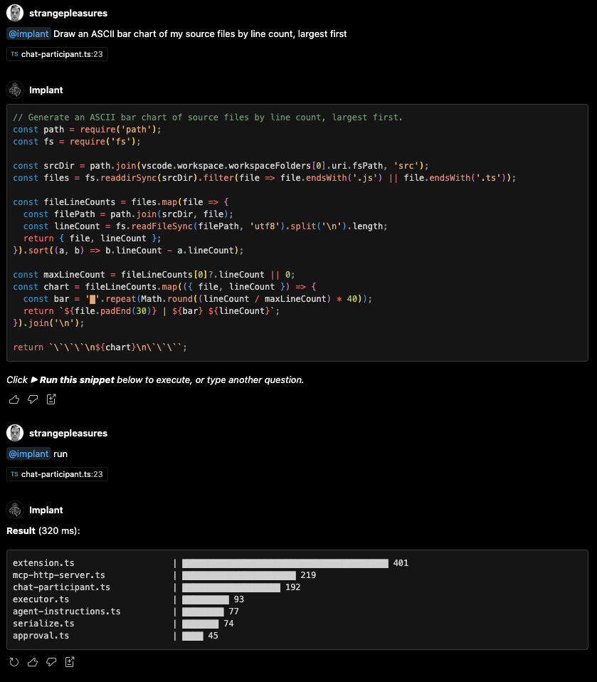

# Implant

Give coding agents (Copilot Chat, Claude Code, Cursor, anything that speaks MCP —
or anything that can shell out) live access to everything that lives inside VS Code
and third-party extensions.

**Explore the code with the tools the editor already has:** Find References,
Go-to-Definition, hover types, workspace diagnostics, git blame, symbol outlines,
and any command a third-party extension registers.

**Modify the code through the same language server that powers the editor:**
structural rename, quick-fixes and refactors, organize imports, safe file
create/rename/delete via `WorkspaceEdit`, formatter output, source actions. Edits
go through the language server — safer than `sed`/`awk` on files because they
respect scope, imports, and semantics.

Implant exposes a single MCP tool, `run_vscode_script`, that executes a JavaScript
snippet inside the running VS Code extension host with full access to the
`vscode.*` API. Nothing runs without the user approving the exact snippet.

## Quick start

1. Install the extension.
2. Open your project. Implant will offer to install itself into the workspace —
   this drops portable rule files that teach agents when to reach for Implant.
3. Your agent picks up the tool automatically — MCP-native clients (Copilot Chat
   and others on VS Code ≥ 1.101) discover it via the registry, and CLI agents
   pick it up from the workspace instructions installed in step 2.
4. When an agent invokes the tool, a webview opens beside the editor showing the
   script with syntax highlighting. Click **Run**, **Run + trust session**, or
   **Deny**.

You can also ask Implant directly in Copilot Chat via **`@implant`** — see below.

## `@implant` in Copilot Chat

Type `@implant …` in Copilot Chat with a natural-language request. Implant asks
the language model to translate your ask into a `vscode.*` snippet, shows you
the snippet, runs it through the same approval flow as any other invocation,
and streams the result back into the chat.

Examples of things that aren't one-click in the UI:

- `@implant list every TODO / FIXME / HACK comment across the workspace, grouped by tag, with clickable file:line links.`
- `@implant which exported symbols in src/ have zero references? Those are dead-code candidates.`
- `@implant sort my open tabs by diagnostic count so I know which file to fix first.`
- `@implant give me a bug-report snapshot: VS Code version, active user extensions, open tabs, dirty files, and per-language diagnostic count. Format it as GitHub-ready Markdown.`
- `@implant list the top 20 functions in this workspace by cross-file reference count.`
- `@implant preview what a project-wide rename of \`foo\` → \`bar\` would touch — file count and line count per file, no changes applied.`

Requires GitHub Copilot for the language model. Read-only queries and refactor
dry-runs are the sweet spot; anything that modifies files still opens the
approval webview so you can eyeball the exact snippet before it runs.

## Palette commands

| Command | Purpose |
| --- | --- |
| **Implant: Install into Workspace** | Writes five portable, safe-to-commit files: `.vscode/implant/call.js` (stdio↔HTTP MCP proxy), `.mcp.json` (Claude Code / generic MCP config), `.cursor/mcp.json` (Cursor MCP config), `.claude/skills/implant/SKILL.md` (Claude Code skill), `.cursor/rules/implant.mdc` (Cursor rules). Also upserts an `<!-- BEGIN Implant --> … <!-- END Implant -->` section into `.github/copilot-instructions.md`. Prompts before overwriting; asks which folder in multi-root workspaces. |
| **Implant: Copy Agent Instructions** | Copies the same instructions to the clipboard — paste into `AGENTS.md`, an agent's system prompt, or wherever your setup expects. |

## Settings

| key | default | meaning |
| --- | --- | --- |
| `implant.requireConfirmation` | `true` | Show the approval webview before each script runs. |
| `implant.timeoutMs` | `0` | Hard execution timeout in ms. `0` disables it — long-running async scripts are cancelled by the user via a notification that appears after 10 seconds. Set to a positive value to enforce an automatic upper bound. |
| `implant.port` | `0` | Port for the HTTP MCP server. `0` picks an ephemeral one; the actual port is written to `.vscode/implant/session.yml`. |

The approval webview has a **Run + trust session** button that skips future
prompts until the window is reloaded.

## Safety notes

- Snippets run in the VS Code extension host with the same privileges as the
  extension itself. There is no sandbox — that is the entire point.
- The approval webview exists so you can eyeball each snippet before it runs.
  Turn confirmation off only when the agent is already in a tight review loop.
- The HTTP server only binds to `127.0.0.1` and requires a per-session bearer
  token — the token lives in `.vscode/implant/session.yml` (mode `0600`, gitignored,
  regenerated on every activation). Requests without a valid token get `401` and
  raise a warning notification so you notice anything poking at the port.
- Even with the token gate, don't run this on a shared machine: any process
  running as your user can read the session file.
- The confirmation prompt is the last line of defense. Only turn
  `implant.requireConfirmation` off when the agent is already in a tight review
  loop that you trust.
